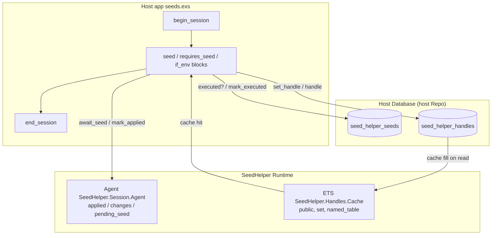

# Project Architecture

## Overview

SeedHelper is an Elixir library that provides **idempotent, dependency-aware database seeding** for Ecto applications. It wraps seed blocks in macros that track execution in the database, resolve inter-seed dependencies at runtime via an Agent process, and support environment-conditional execution. The library is designed to be called from `priv/repo/seeds.exs` files within a session lifecycle.

The library owns no process tree and no supervision tree of its own: `begin_session/0` starts a bare `Agent` (named `SeedHelper.Session.Agent`) and an ETS table (named `SeedHelper.Handles.Cache`), and `end_session/0` stops the Agent. Nothing is started by an OTP application callback — `mix.exs` declares only `extra_applications: [:logger]`, so a host app must call `begin_session/0` explicitly.

The consuming repo's Ecto Repo module is bound at **compile time** via `Application.compile_env!(:seed_helper, :repo)` in `SeedHelper.Seeds` and `SeedHelper.Handles`; a host app that fails to set it cannot compile against the library.

## System Diagram

## Core Components

| Component | Purpose |
|-----------|---------|
| `SeedHelper` | Public API — macros `seed`, `requires_seed`, `if_env`; functions `set_handle`, `handle`, `begin_session`, `end_session` |
| `SeedHelper.Session` | Agent-based session lifecycle: applied set, pending change queue, unblocking |
| `SeedHelper.Seeds` | DB-backed seed tracking — `executed?/1`, `mark_executed/1` |
| `SeedHelper.Handles` | Named value store — term-encoded column plus ETS read cache |
| `SeedHelper.Migration` | Ecto migration module — `up(1)`/`down(1)` create the two tables |
| `SeedHelper.Schema.Seeds` | Ecto schema for `seed_helper_seeds` (composite PK `{seed, version}`) |
| `SeedHelper.Schema.Handles` | Ecto schema for `seed_helper_handles` (PK `handle`) |

→ *Components ↔ directories: see [PROJ-LAYOUT.md](PROJ-LAYOUT.md). Data shapes: see [PROJ-SCHEMA.md](PROJ-SCHEMA.md).*

## Data Flow

1. `begin_session/0` creates the ETS cache table (`:public, :set, :named_table, read_concurrency: true`) and starts the session Agent holding `applied`, `changes`, `changes_pending` and `pending_seed`.
2. `seed/3` calls `SeedHelper.Seeds.executed?/1`; if the `{name, version}` pair is absent it runs the block, `IO.puts` an "Executed" line, writes the row via `mark_executed/1`, then calls `Session.mark_applied/2`, which returns any change closures unblocked by that seed and applies each one.
3. `requires_seed/2` rejects already-executed prerequisites; with none left it runs the block immediately, otherwise it hands the closure to `Session.await_seed/2`, which parks it under a fresh `UUID.uuid4()` change key until every required seed is applied.
4. `if_env/2` compares `Mix.env()` against the given atom or list and runs the block only on a match; an empty list always runs.
5. `end_session/0` reads `changes_pending`, stops the Agent, and returns `:ok` or `{:error, {:unprocessed_changes, pending}}` for anything still blocked.

Both `executed?/1` and `mark_executed/1` `String.trim/1` the seed name and version before querying or inserting, so `{"My Seed", "1"}` and `{" My Seed ", "1"}` are the same seed.

## Key Design Decisions

- **Agent for the dependency graph**: seed files are single-run and sequential, so plain in-process Agent state avoids a GenServer/supervision tree and any shutdown protocol.
- **ETS for the handle cache**: handles are read repeatedly after first write; a `:public` named table gives lock-free concurrent reads and lets the seeding code read without going through the Agent.
- **DB-backed idempotency**: `seed_helper_seeds` is the durable record; the Agent's `applied` set is per-session only.
- **Term-encoded handle values**: values are `:erlang.term_to_binary/1` → `Base.encode64/1` into a `text` column, so arbitrary Elixir terms survive the round trip without per-type columns.
- **Macro-based API**: `seed`, `requires_seed` and `if_env` expand inline in the host's seed script, so no runtime DSL parsing is needed.

## Technology Stack

| Layer | Technology |
|-------|-----------|
| Language | Elixir ~> 1.10 (CI pins 1.17.3 / OTP 27.1.2) |
| Database | Ecto SQL ~> 3.6 (any Ecto-supported DB; the lib never opens a connection itself) |
| Caching | ETS (in-process, public named table) |
| State | Agent (in-process) |
| ID Generation | elixir_uuid (change keys in `Session`) |
| Packaging | Hex, published as `:seed_helper` |
| CI | GitHub Actions — `mix compile --warnings-as-errors` + `mix test` (no database service) |
