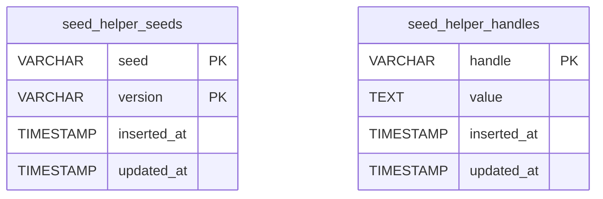
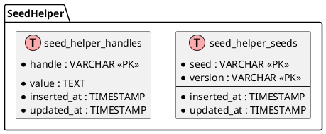

# Project Schema

## Overview

SeedHelper owns **two relational tables** and **no Liquibase changelogs**. The
tables are created by `SeedHelper.Migration.up(1)` from *inside the host
application's* migration directory — the library ships the migration module, not
the changeset:

```elixir
def up,   do: SeedHelper.Migration.up(1)
def down, do: SeedHelper.Migration.down(1)
```

Consequently there is no `liquibase/` tree and no migration history in this repo;
the authoritative source is `lib/seed_helper/migration.ex` plus the two Ecto
schemas in `lib/seed_helper/schema/`. Schema version `1` is the only version.

Beyond the relational tables the repo carries four further data shapes, documented
in [Non-relational schemas](#non-relational-schemas) below: the compile-time
config contract, the ETS handle cache, the session Agent's state map, and the wire
shape of a handle value.

→ *Source locations: see [PROJ-LAYOUT.md](PROJ-LAYOUT.md).*

## Entity Relationship Diagram



There are **no foreign keys and no relationships** between the two tables. They
are independent stores that happen to be created by the same migration: one
records which `{seed, version}` pairs have run, the other holds named values that
seed blocks hand to each other.



## Seed Tracking

Idempotency ledger for seed blocks. One row per applied seed-version pair.

### seed_helper_seeds

| Column | Type | Nullable | Default | Description |
|--------|------|----------|---------|-------------|
| seed | string (varchar) | No | — | Seed name; part of the composite PK. Trimmed by `Seeds.executed?/1` and `mark_executed/1` |
| version | string (varchar) | No | — | Seed version; part of the composite PK. Trimmed likewise |
| inserted_at | utc_datetime_usec | No | — | Ecto `timestamps/1` |
| updated_at | utc_datetime_usec | No | — | Ecto `timestamps/1` |

**Primary key**: composite `(seed, version)` via `primary_key: false` + two
`primary_key: true` fields — the reason `Seeds` uses `Repo.get_by/2` rather than
`Repo.get/2`.
**Indexes**: none beyond the composite PK.
**Readers/writers**: `SeedHelper.Seeds.executed?/1` (select), `SeedHelper.Seeds.mark_executed/1`
(insert with `on_conflict: :nothing`).
**Schema module**: `SeedHelper.Schema.Seeds` (`@primary_key false`).

## Handle Store

Cross-seed named values. One row per handle.

### seed_helper_handles

| Column | Type | Nullable | Default | Description |
|--------|------|----------|---------|-------------|
| handle | string (varchar) | No | — | Handle name, PK. Upsert conflict target |
| value | **text** | No | — | `:erlang.term_to_binary/1` output, `Base.encode64/1`-encoded |
| inserted_at | utc_datetime_usec | No | — | Ecto `timestamps/1` |
| updated_at | utc_datetime_usec | No | — | Ecto `timestamps/1` (also set explicitly in the upsert's `on_conflict` set list) |

**Primary key**: `handle`.
**Indexes**: none beyond the PK — the `conflict_target: [:handle]` upsert rides the PK.
**Constraints**: `value` is `text NOT NULL`; no length cap, so large terms produce large blobs.
**Readers/writers**: `SeedHelper.Handles.set_handle/2` (`Repo.insert!/2` with
`on_conflict: [set: [...]]`), `SeedHelper.Handles.handle/2` (`Repo.get/2` on cache miss).
**Schema module**: `SeedHelper.Schema.Handles`.

Note the mismatch to watch for: the Ecto **schema** declares `field :value, :string`
while the **migration** creates it as `:text` — both map to an unbounded string in
Postgres, so this is harmless but the migration is authoritative.

## Handle Value Encoding

A handle value is a two-step encoding, applied in `set_handle/2` and reversed in
`handle/2`:

```text
term  --:erlang.term_to_binary/1-->  binary  --Base.encode64/1-->  ASCII text  --DB text column-->
text  --Base.decode64!/1-->  binary  --:erlang.binary_to_term/1-->  term
```

The decode path uses `:erlang.binary_to_term/1` **without** the `[:safe]` option —
see [THREAT-MODEL.md](THREAT-MODEL.md) T-001.

## Non-relational schemas

### Config contract

| Key | Type | Read by | When |
|-----|------|---------|------|
| `:seed_helper` / `:repo` | module (an Ecto Repo) | `SeedHelper.Seeds`, `SeedHelper.Handles` | **compile time**, via `Application.compile_env!/2` |

`config/config.exs` ships a placeholder (`repo: MyApp.Repo`) that a host app
replaces. Because the read is `compile_env!`, setting the value after the library
is compiled has no effect and an unset value fails compilation.

### ETS cache

| Property | Value |
|----------|-------|
| Table name | `SeedHelper.Handles.Cache` (named) |
| Options | `[:public, :set, :named_table, read_concurrency: true]` |
| Row shape | `{handle :: String.t, value :: term}` |
| Miss sentinel | `{SeedHelper.Handles, :cache_miss}` — cached so a missing handle is only looked up in the DB once |
| Created by | `SeedHelper.Handles.init/0`, called from `Session.begin_session/0` |
| Lifetime | The owning process — dies with the seeding run |

### Session Agent state

| Key | Shape | Meaning |
|-----|-------|---------|
| `applied` | `MapSet.t({name, version})` | Seeds applied in this session |
| `changes` | `%{change_id => (-> any)}` | Parked closures |
| `changes_pending` | `%{change_id => [{name, version}]}` | Remaining prerequisites per closure |
| `pending_seed` | `%{ {name, version} => [change_id] }` | Reverse index, seed → waiting closures |

`change_id` is a fresh `UUID.uuid4/0` per `await_seed/2` call.

### Public API surface

| Call | Kind | Contract |
|------|------|----------|
| `seed({name, version}, opts \\ [], do: block)` | macro | Runs `block` once per `{name, version}`; `opts[:only]` gates on `Mix.env()` |
| `requires_seed(seed_or_seeds, do: block)` | macro | Runs now, or parks until prerequisites are applied |
| `if_env(env_or_envs, do: block)` | macro | Runs `block` when `Mix.env()` matches; `[]` always runs |
| `set_handle(name, term)` | function | Upserts the encoded term; `:ok` |
| `handle(name, default \\ nil)` | function | Cached/DB lookup, else `default` |
| `begin_session/0` | function | Creates ETS table, starts the Agent |
| `end_session/0` | function | Stops the Agent; `:ok` or `{:error, {:unprocessed_changes, pending}}` |
