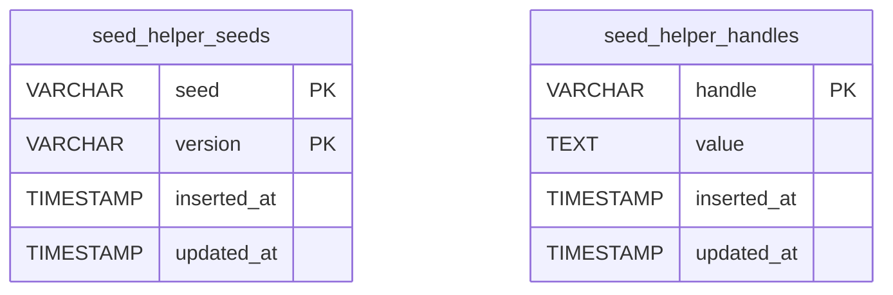

**Relational**: two independent tables, no foreign keys. Created by `SeedHelper.Migration.up(1)` inside the host app — no Liquibase changelogs live in this repo.

| Table | PK | Columns | Used by |
|---|---|---|---|
| `seed_helper_seeds` | composite `(seed, version)` | seed, version, inserted_at, updated_at | `Seeds.executed?/1`, `Seeds.mark_executed/1` |
| `seed_helper_handles` | `handle` | handle, value (text, base64 of `term_to_binary`), inserted_at, updated_at | `Handles.set_handle/2`, `Handles.handle/2` |

No indexes beyond the PKs. No enums. Timestamps are `utc_datetime_usec` from Ecto `timestamps/1`.

**Non-relational**: config contract `:seed_helper, :repo:` read at **compile time** via `Application.compile_env!/2`; ETS cache `SeedHelper.Handles.Cache` (`:public, :set, :named_table, read_concurrency: true`, miss sentinel `{SeedHelper.Handles, :cache_miss}`); session Agent state `applied`/`changes`/`changes_pending`/`pending_seed` keyed by `UUID.uuid4()` change ids.

**Encoding risk**: handle values decode with `:erlang.binary_to_term/1` without `[:safe]` (see THREAT-MODEL T-001).
