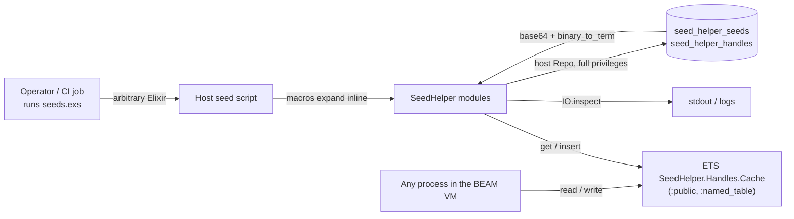

# Threat Model

## Overview

SeedHelper is a **library, not a service**: it opens no ports, serves no HTTP,
holds no credentials and ships no ingress or container config. Its entire attack
surface is the boundary between the code that *calls* it and the two Postgres
tables it reads and writes through whatever Repo the host app binds at compile
time.

The crown jewels are therefore not the library's own data but two things it
touches: **the host application's database connection** (the library executes
queries with the host's full Repo privileges) and **the integrity of the seed
ledger** — if `seed_helper_seeds` can be written by anything other than a
successful seed run, an operator can be silently denied data they believe was
seeded.

Three trust boundaries matter. (1) The seed script boundary: `seed`,
`requires_seed` and `if_env` expand *inline* into the host's `seeds.exs`, so
everything in that file runs with full application privileges — there is no
sandboxing, and the library does not attempt any. (2) The database boundary:
handle values are round-tripped through `:erlang.binary_to_term/1`, so anything
that can write `seed_helper_handles` is treated as trusted input by the seeding
process. (3) The BEAM node boundary: the handle cache is a `:public` named ETS
table, readable and writable by every process in the VM.

→ *Assets and components: see [PROJ-ARCH.md](PROJ-ARCH.md). Tables and encodings: see [PROJ-SCHEMA.md](PROJ-SCHEMA.md).*

## Attack Surface

There is **no network ingress, no authentication layer, no authorisation layer
and no secret handling** in this repository — no such code exists to model.

## Vulnerability Register

| ID | Severity | STRIDE | Component | Status |
|----|----------|--------|-----------|--------|
| T-001 | High | Tampering / Elevation of privilege | `SeedHelper.Handles.handle/2` decodes DB values with `:erlang.binary_to_term/1` **without** `[:safe]` | Open |
| T-002 | Medium | Tampering | `SeedHelper.Handles.init/0` creates a `:public, :named_table` ETS cache | Open |
| T-003 | Medium | Tampering / Repudiation | `SeedHelper.Seeds.mark_executed/1` writes a ledger row with no proof the block ran | Open |
| T-004 | Low | Information disclosure | `SeedHelper.Seeds.executed?/1` `IO.inspect`s seed name and version on every check | Open |
| T-005 | Low | Tampering | `SeedHelper.if_env/2` gates on ambient `Mix.env()` | Open |
| T-006 | Low | Denial of service | `seed_helper_handles.value` is unbounded `text` with no size cap | Open |

### T-001 — Unsafe term decoding of stored handle values

`SeedHelper.Handles.handle/2` loads a DB value and calls
`Base.decode64!/1` then `:erlang.binary_to_term/1` with no options. `binary_to_term/1`
will instantiate any term encoded by `term_to_binary/1`, including funs and
references; the `[:safe]` flag exists precisely to refuse those. Anything able to
write a row into `seed_helper_handles` — a compromised host app, a shared
database, a fixture loader, or a migration in another service — can therefore
influence what the seeding process deserialises. Exposure is bounded by the fact
that funs cannot be *called* directly by `binary_to_term` alone, but the
deserialisation still allocates attacker-chosen terms in the seeding process, and
this is the classic anti-pattern. Status: **Open** — fix is one option flag.

### T-002 — Public named ETS cache

`Handles.init/0` uses `[:public, :set, :named_table, read_concurrency: true]`, so
every process on the node can read and overwrite cached handles by name, and can
create the table with clashing options before `begin_session/0` runs. A poisoned
cache entry is returned by `handle/2` without a DB check, so a later seed can be
handed an attacker-chosen value (for example an id pointing at a different row).
Severity is capped by the fact that the seeding run is a short-lived operator
task, not a long-running service. Status: **Open**.

### T-003 — Ledger rows written without execution proof

`mark_executed/1` is public and inserts the `{seed, version}` row with
`on_conflict: :nothing`; nothing ties the write to the block having executed.
Any code in the host app — or a person with DB write access — can mark every seed
applied, after which `seed` blocks become no-ops and the environment silently
lacks the data they assume. This is the highest-impact *integrity* issue in the
library in practice. Status: **Open** — inherently unfixable in a library with no
identity model; recorded so operators know the ledger is advisory, not attested.

### T-004 — Debug output of seed keys

`SeedHelper.Seeds.executed?/1` calls `IO.inspect(seed, label: "SEED")` and
`IO.inspect(version, label: "version")` before querying, so every idempotency
check writes the seed name and version to stdout. Seed keys are not secrets by
design, but the output is unconditional and will land in CI logs and any log
aggregator. Status: **Open** (low).

### T-005 — Environment gating via ambient `Mix.env()`

`if_env/2` compares against `Mix.env()`, which resolves from `MIX_ENV` in the
ambient environment. A run with an unexpected (or defaulted-to-`:dev`) `MIX_ENV`
will take the wrong branch — most importantly, prod-gated seeds will not run, or
test-only seeds will run against a non-test database. This is a configuration
integrity issue, not an attacker-controlled one. Status: **Open** (low).

### T-006 — Unbounded handle value size

The migration declares `value` as `text` with no length limit and the library
enforces none, so a single `set_handle/2` with a large term writes an arbitrarily
large blob; repeated writes bloat the table and slow cache-miss reads. Status:
**Open** (low) — accepted for a library whose callers are trusted operators.

## Mitigation Coverage

0 mitigated · 0 partial · 6 open. There is no code in this repository that
authenticates a caller, authorises a write, or validates a stored value, so no
control can be claimed as implemented; the register is an honest inventory rather
than a scorecard.

Compensating controls that exist **outside** this repo, and that the register
assumes: database access is granted only to the application's own role; seed runs
are operator/CI-driven rather than user-triggered; `MIX_ENV` is fixed by the
deployment tooling.

## Residual Risk

Accepted by design:

- **Trusted operators and trusted seed authors.** Seed files are arbitrary Elixir
  that runs with full application privileges; the library provides no isolation
  and cannot.
- **Trusted database.** Handle values are deserialised without validation
  (T-001); the model assumes nobody but the host application writes
  `seed_helper_handles`.
- **Advisory ledger.** `seed_helper_seeds` records intent, not proof (T-003).
  Operators verifying that data exists must query the data itself.
- **Single-node, single-run.** The Agent is unnamed per node and the seeding run
  is expected to be one process; concurrent seeding runs against one database are
  not defended against and would race on `pending_seed` state.
